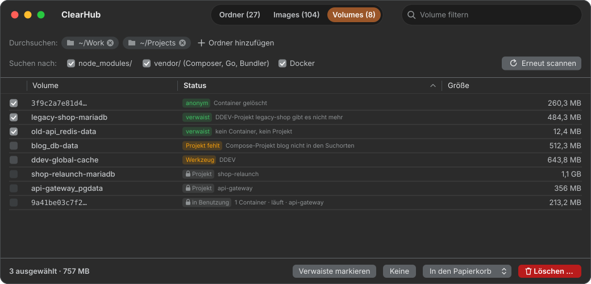

# ClearHub

A native macOS app (SwiftUI + AppKit) that searches your project folders for `node_modules/` and `vendor/`, finds outdated Docker images and orphaned Docker volumes and deletes them selectively. It gets back the disk space that old projects take up. Runs entirely locally – no Xcode, no Apple developer certificate. The interface is always dark: a Darcula look with neutral greys, ClearHub's orange marking its primary actions.



<sub>Mockup with sample data, not a real screenshot. The app's interface is in German; labels are quoted below with their English meaning.</sub>

## Installation

**Requirements:** macOS 14 or later and the Command Line Tools (`xcode-select --install`).

```bash
git clone https://github.com/marionitschke/clearhub.git
cd clearhub
./build.sh --install
```

The app is then located at `/Applications/StudioHub/ClearHub.app`. Because it is built on your Mac and signed ad hoc, it launches without a Gatekeeper prompt. The first scan of `~` makes macOS ask for access to Desktop, Documents and Downloads – allow it, otherwise matches are missing.

- **Update:** `git pull && ./build.sh --install`
- **Uninstall:** `rm -rf /Applications/StudioHub/ClearHub.app && defaults delete local.clearhub`

## Features

- **Search locations of your choice:** any number of folders (default: `~`), remembered between launches.
- **`node_modules/`** – detects npm, Yarn, pnpm and Bun by their lockfile.
- **`vendor/`** – only real project dependencies: next to `composer.json`, `go.mod` or `Gemfile`, and only if the package manager created it (`vendor/composer/`, `vendor/modules.txt`; for Bundler nothing but `vendor/bundle/`, since a Rails app's `vendor/` also holds committed code).
- **Docker images** – a separate view with a status per image (see below), plus unused build cache.
- **Docker volumes** – a third view with a status per volume; orphaned volumes can be deleted.
- **Size and age** – sortable by size, type or **Projekt geändert** (project modified), filterable by path.
- **Deletion** – to the Trash (default) or permanently, always after confirmation.
- **Erneut scannen** (scan again) – the button is highlighted as soon as search locations or types have changed.

### Docker: what can go?

| Status | Meaning | Deletable |
| --- | --- | --- |
| **in Benutzung** (in use) 🔒 | A running or stopped container uses the image | No – Docker refuses |
| **Projekt** (project) | No container, but a `compose.yaml` or DDEV project in your search locations uses it on its next start | Yes, costs a rebuild/pull |
| **dangling** | Old version without a tag | Yes, safely |
| **verwaist** (orphaned) | Neither a container nor a known project | Yes |
| **Build-Cache** | Unused cache (`docker builder prune`) | Yes, the next build takes longer |

**Verwaiste markieren** (mark orphaned) only selects dangling, orphaned and build cache. The size shown is the space used only by that image – shared layers are freed only once every image using them is gone. Images are always removed permanently (no Trash). Docker Desktop, OrbStack, Colima and Rancher Desktop are detected.

### Docker volumes: what can go?

Volumes hold data such as databases – unlike images, nothing brings them back. ClearHub is therefore stricter here:

| Status | Meaning | Deletable |
| --- | --- | --- |
| **in Benutzung** (in use) 🔒 | A running or stopped container mounts the volume | No – Docker refuses |
| **Projekt** (project) 🔒 | A Compose or DDEV project on disk keeps its data here | No |
| **Werkzeug** (tool) | Used by DDEV itself (global cache, SSH agent), recreated on the next start | Yes |
| **Projekt fehlt** (project missing) | Labelled for a Compose project that the scan did not find – it may live outside the search locations | Yes, individually |
| **anonym** (anonymous) | Left behind by a removed container | Yes |
| **verwaist** (orphaned) | Neither a container nor a known project, or a DDEV project that DDEV no longer knows | Yes |

**Verwaiste markieren** only selects anonymous and orphaned volumes. DDEV projects are also found outside the search locations via `~/.ddev/project_list.yaml`; Compose has no such list, so add the folder of a project shown as **Projekt fehlt** if you still need it. Volumes are always removed permanently.

### Safety

- Hidden folders (`.git`, `.nvm`, `.cache` …), `~/Library` and system folders are never searched.
- Nested `node_modules` are not listed individually – only the top-level folder per project.
- Only folders actually named `node_modules` or `vendor` are deleted, and only if they are still real folders – one replaced by a link since the scan is skipped. Links inside them are removed, never their targets.
- Docker images are removed without `--force`; volumes in use or owned by a project are never deleted.
- A Docker call that gets no answer (e.g. a stuck Docker Desktop) is stopped after a few minutes instead of blocking the app.

## Usage

| Action | Shortcut |
| --- | --- |
| Scan / scan again | ⌘R |
| Add folder | ⌘O |
| Mark selected rows | Space |
| Show in Finder | Double-click |
| Delete marked | ⌘⌫ |

## Building

Only the Command Line Tools are needed, no Xcode:

```bash
./build.sh            # build/ClearHub.app
./build.sh --install  # also copies it to /Applications/StudioHub (stops if ClearHub is running)
./build.sh --icon     # redraws the app icon (scripts/make-icon.swift → Resources/AppIcon.icns)
scripts/check.sh      # checks scan, deletion and Docker classification in temporary folders
```

## Structure

| Path | Contents |
| --- | --- |
| `Sources/ClearHub/Scanner.swift` | Directory scan, detection, size calculation |
| `Sources/ClearHub/Deleter.swift` | Trash / permanent deletion |
| `Sources/ClearHub/Docker.swift` | Docker CLI, image and volume status, Compose/DDEV mapping |
| `Sources/ClearHub/AppModel.swift` | State, background scan, settings |
| `Sources/ClearHub/ContentView.swift` | Interface (folders) |
| `Sources/ClearHub/DockerView.swift` | Interface (Docker) |
| `Sources/ClearHub/Darcula.swift` | Darcula palette, graphite accent, dark window, primary buttons |
| `Tests/Checks.swift` | Checks for scan, deletion and Docker classification |
