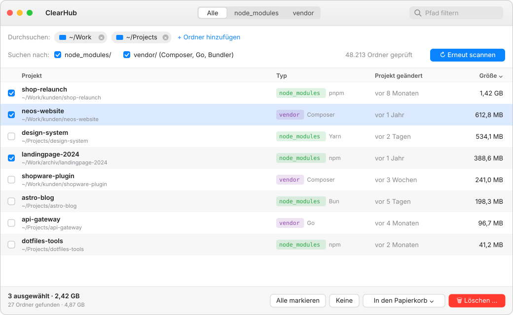

# ClearHub


Native macOS-App (SwiftUI + AppKit), die deine Projektordner nach `node_modules/` und `vendor/` durchsucht, veraltete Docker-Images findet und beides gezielt löscht. So holst du dir Speicherplatz zurück, den alte Arbeitsprojekte belegen.



<sub>Mockup zur Veranschaulichung, kein echter Screenshot.</sub>

## Funktionen

- **Suchorte frei wählbar:** beliebig viele Ordner (Standard: `~`), werden gespeichert.
- **`node_modules/`** – erkennt npm, Yarn, pnpm und Bun am Lockfile.
- **`vendor/`** – nur echte Projekt-Abhängigkeiten: neben `composer.json`, `go.mod` oder `Gemfile`.
- **Docker-Images** – eigene Ansicht mit Status pro Image (siehe unten), plus ungenutzter Build-Cache.
- **Größe und Alter** – sortierbar nach Größe, Typ oder „Projekt geändert“, filterbar nach Pfad.
- **Löschen** – in den Papierkorb (Standard) oder endgültig, immer mit Bestätigung.
- **Erneut scannen** – der Button wird hervorgehoben, sobald Suchorte oder Typen geändert wurden.

### Docker: was kann weg?

| Status | Bedeutung | Löschbar |
| --- | --- | --- |
| **in Benutzung** 🔒 | Ein laufender oder gestoppter Container nutzt das Image | Nein – Docker verweigert es |
| **Projekt** | Kein Container, aber eine `compose.yaml` oder ein DDEV-Projekt in deinen Suchorten nutzt es beim nächsten Start | Ja, kostet dann Rebuild/Pull |
| **dangling** | Alte Version ohne Tag | Ja, gefahrlos |
| **verwaist** | Weder Container noch bekanntes Projekt | Ja |
| **Build-Cache** | Ungenutzter Cache (`docker builder prune`) | Ja, nächster Build dauert länger |

„Verwaiste markieren“ erfasst nur dangling, verwaist und Build-Cache. Angezeigt wird der Platz, den nur dieses Image belegt – geteilte Schichten werden erst frei, wenn alle Images weg sind, die sie nutzen. Images werden immer endgültig entfernt (kein Papierkorb). Erkannt werden Docker Desktop, OrbStack, Colima und Rancher Desktop.

### Sicherheit

- Versteckte Ordner (`.git`, `.nvm`, `.cache` …), `~/Library` und Systemordner werden nie durchsucht.
- Verschachtelte `node_modules` werden nicht einzeln gelistet – nur der oberste Ordner pro Projekt.
- Gelöscht wird nur, was tatsächlich `node_modules` bzw. `vendor` heißt.
- Docker-Images werden ohne `--force` entfernt.

## Bedienung

| Aktion | Kürzel |
| --- | --- |
| Scannen / erneut scannen | ⌘R |
| Ordner hinzufügen | ⌘O |
| Ausgewählte Zeilen markieren | Leertaste |
| Im Finder zeigen | Doppelklick |
| Markierte löschen | ⌘⌫ |

Beim ersten Scan von `~` fragt macOS nach Zugriff auf Schreibtisch, Dokumente und Downloads – erlauben, sonst fehlen Treffer.

## Bauen

Voraussetzung: macOS 14+, Xcode bzw. Swift 5.10+.

```bash
./build.sh
open build/ClearHub.app
```

`build.sh` baut im Release-Modus, erzeugt `build/ClearHub.app` und signiert ad hoc.

App-Icon neu erzeugen (nach Änderungen an `Scripts/make-icon.swift`):

```bash
swift Scripts/make-icon.swift
```

Tests:

```bash
swift test
```

## Aufbau

| Pfad | Inhalt |
| --- | --- |
| `Sources/ClearHubCore/Scanner.swift` | Verzeichnis-Scan, Erkennung, Größenberechnung |
| `Sources/ClearHubCore/Deleter.swift` | Papierkorb / endgültig löschen |
| `Sources/ClearHubCore/Docker.swift` | Docker-CLI, Image-Status, Compose-/DDEV-Zuordnung |
| `Sources/ClearHub/AppModel.swift` | Zustand, Hintergrund-Scan, Einstellungen |
| `Sources/ClearHub/ContentView.swift` | Oberfläche (Ordner) |
| `Sources/ClearHub/DockerView.swift` | Oberfläche (Docker) |
| `Scripts/make-icon.swift` | Zeichnet das App-Icon → `Resources/AppIcon.icns` |
| `Tests/ClearHubCoreTests` | Unit-Tests für Scan, Löschen und Docker-Einordnung |
